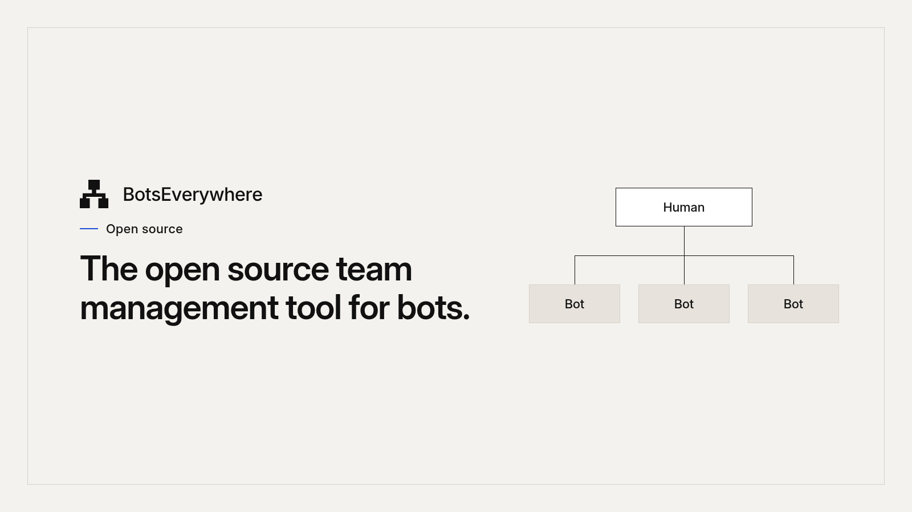
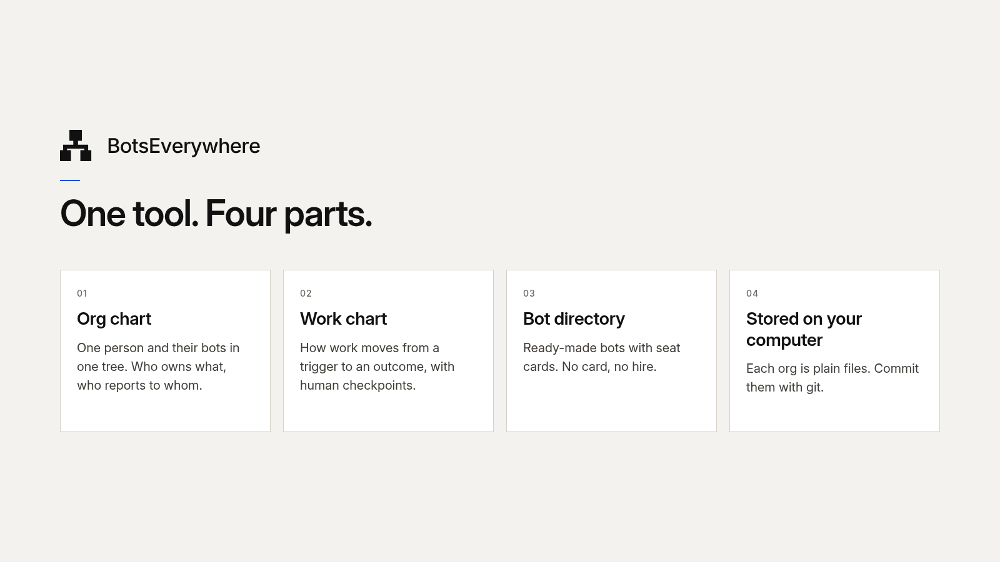
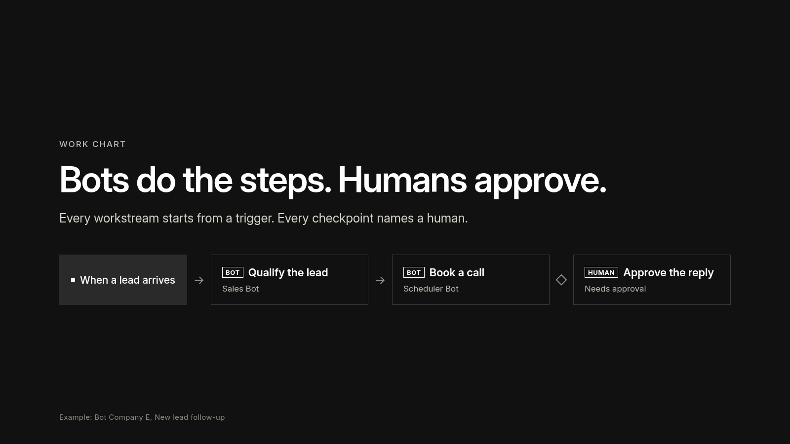
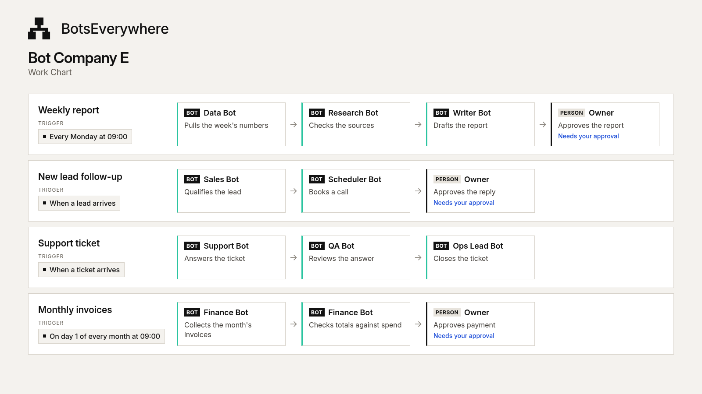
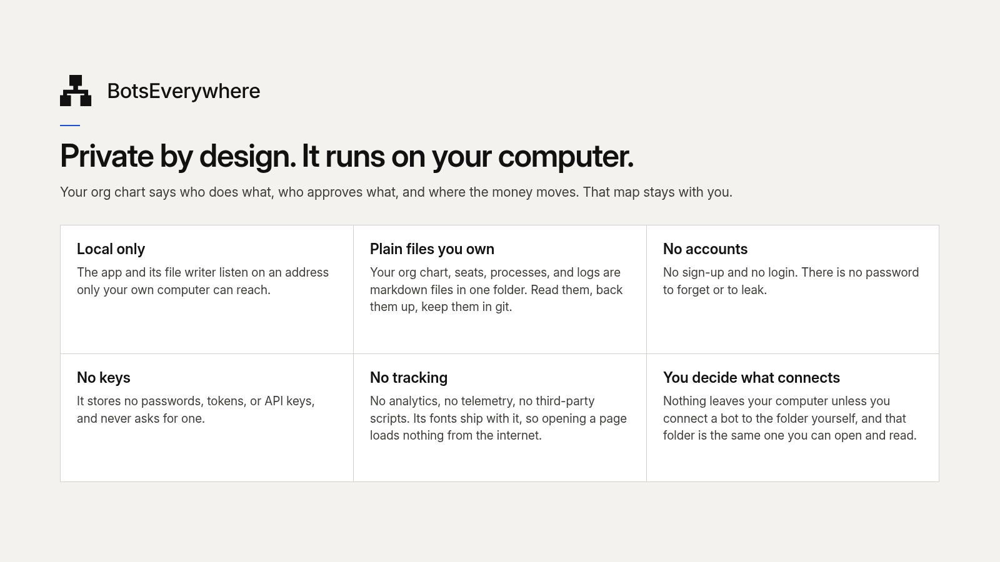
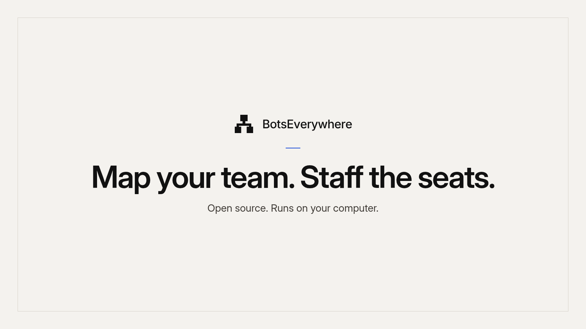

# BotsEverywhere



BotsEverywhere is an open source team management tool for bots.

Organizations copy it to map their team of bots in one place: an org chart, a work chart of who does what and when, and a directory of ready-made bots they can add to Grok Bot. Their data stays on their own computer.

There are no API keys in the frontend. BotsEverywhere is open source under the [MIT License](LICENSE).

Full install steps, including Windows PowerShell and an optional static host, are in [SETUP.md](SETUP.md). How the two builds, the folders, and the Connector fit together is in [docs/ARCHITECTURE.md](docs/ARCHITECTURE.md). Where the work stands is in [docs/STATUS.md](docs/STATUS.md).

Documentation updated 4 November 2026.

## What it is

One tool, four parts: an org chart of one person and their bots, a work chart of how work moves from a trigger to an outcome with human checkpoints, a directory of ready-made bots with seat cards, and plain files on your own computer that you can commit with git.



## How work moves

Bots do the steps. Humans approve. Every workstream starts from a trigger, and every checkpoint names a human.



The work chart of a sample organization, Bot Company E: four workstreams, each a row of bots with the owner's approval where the money or the message leaves.



## Private by design

It runs on your computer. The app and its file writer listen on an address only your own computer can reach. Your org chart, seats, processes, and logs are markdown files in one folder. No accounts, no keys, no tracking. Nothing leaves your computer unless you connect a bot to the folder yourself.



## Dependencies

What you need before you start:

- **A Grok Bot account.** Your bots run there, and one bot in it, the Connector, links Grok Bot to this app. The app itself never calls Grok Bot: the Connector reads and writes files in your `orgs` folder.
- **Node.js 22 or newer, with npm.** From [nodejs.org](https://nodejs.org). `npm install` brings in everything else: Vite, React 19, TypeScript, and the small Node writer that saves your files.
- **Git.** To clone this repository and to update it later with `git pull`.
- **A desktop browser** at least 1024 pixels wide. Chrome, Edge, Firefox, or Safari. The org chart, the work chart, and the logs need the room.
- **Windows, macOS, or Linux.** The app runs on your own computer at `127.0.0.1` and keeps your data in the `orgs` folder beside it.

No accounts other than Grok Bot, no API keys, no database, and no paid service. Optional: Chrome at `/usr/bin/google-chrome` (or `CHROME_PATH`) for one layout test, and the Playwright browsers for the end-to-end tests.

## Run locally

Template mode is the default.

```bash
npm install
npm run dev       # site on http://127.0.0.1:5199 and the file writer on http://127.0.0.1:8787
```

Open [http://127.0.0.1:5199](http://127.0.0.1:5199) and choose **Open your org** to create your first organization. `npm run dev` starts the site and the local file writer together.



To update, run `git pull` and `npm install` in this same folder. Do not clone a fresh copy into a new folder: it starts a new copy with a new Connector, and your bots keep the old copy's instructions. See [SETUP.md](SETUP.md#update-to-a-newer-version).

## Where your data lives

Each org you create is a folder on your own computer:

```
orgs/<slug>/org.md
orgs/<slug>/seats/<slug>.md
orgs/<slug>/work-chart.md
orgs/<slug>/processes/<slug>.md
orgs/<slug>/log/<event>.md
orgs/<slug>/profiles/<seat>.md    written by each bot: its routines, skills, and apps, as it reports them
orgs/<slug>/grok/snapshot.json    written by the app from the Connector's reading
orgs/CONNECTOR.md                 the Connector's rules, written by the app
orgs/grok-data.json               written by the Connector in Grok Bot on every run: every bot and skill it can see
orgs/connector.json               written by the Connector last on each run: when it ran, and the connected apps
```

`directory/` stays at the repo root. It is the shared bot catalog, not part of an org. A save or a hire writes only inside the org folder you picked.

To keep your orgs in step with Grok Bot, copy the Connector prompt from the Connect bots tab and paste it into Grok Bot once. One Connector serves every org in this copy. It runs every 15 minutes unless you change **Runs every** on Connect bots. On each run it reads Grok Bot into `orgs/grok-data.json`, then carries out the app's list: instruction blocks for your bots, skills you added, routines from the Work Chart, and the asks for each bot's own report. Created, Times used, Last active, and Apps used reach Performance on every run; Skills and Automated tasks come from each bot's report, which lands by itself. A skill saved by a bot in Grok Bot reaches its card here the same way. For new bots, missing bots, and routines, **Sync with Grok Bot** on the org tab row previews what changed and applies it when you confirm. Nothing is ever deleted by a sync, and bots are deleted only in Grok Bot.

The writer root is `ORGS_DIR` (default `./orgs`). Nothing is uploaded. `orgs/` is ignored by git because it is your own data: to keep history, add it with `git add -f orgs` and push it only to a private repository, or use **Export** on the Backup tab. `samples/` stays read-only. A fresh clone has no organization until you create one.

Open `#docs` for the steps and `#directory` for the bot directory.

## Modes

| Mode | How to turn it on | What you get |
| --- | --- | --- |
| `template` | default | Your org files under `orgs/`. `npm run dev` starts the site and the file writer. |
| `showcase` | `VITE_APP_MODE=showcase` | Read-only directory for a public site such as botseverywhere.ai. Sample organizations and clone instructions. No editing and no file writer. |

Showcase does not start an API. See SETUP.md.

## Files

```
orgs/<slug>/org.md
orgs/<slug>/seats/<slug>.md
orgs/<slug>/work-chart.md
orgs/<slug>/processes/<slug>.md
orgs/<slug>/log/<event>.md
orgs/<slug>/grok/snapshot.json
samples/<slug>/           read-only sample organizations (copied into orgs/<slug>/)
directory/                bot prompts, one markdown file per bot, plus PUBLISH-QUEUE.md
```

Seat frontmatter:

```markdown
---
title: Research
department: delivery
reportsTo: you
addToGrokBotUrl: ""
status: active
kind: bot
role: Briefs
personId: ""
hiredAt: ""
retiredAt: ""
directoryId: ""
---

## Owns
...

## May
...

## Needs approval
...

## Done when
...
```

`addToGrokBotUrl` must be empty or match `https://x.ai/bot/…`. Do not invent a link. When it is set, the seat card shows **Add to Grok Bot**. An empty link hides that button. Saving never deletes a seat file; retire the seat instead. Each log event is one file under `orgs/<slug>/log/`.

The static build loads these files with Vite `import.meta.glob`. The file writer binds to `127.0.0.1` only, refuses `NODE_ENV=production`, and is not part of the hosted site.

## Checks

```bash
npm run validate:org    # orgs/ and samples/*/
npm run validate:directory
npm run validate:bots   # curated bots/*.md catalog
npm test
npm run lint
npm run build
```

## Brand

The mark is the Org Bracket (option G). Files live in `brand-kit/v2/logo/final/` and are copied into `public/` (`lockup-ink.svg` in the nav at 26px and in the footer at 24px, `mark-favicon-ink.svg` at 32px and below). Do not recolor, stretch, or retype the outlined wordmark. The app style guide is `src/styles/tokens.css` (it imports `brand-kit/v2/tokens.css` and overrides the page background to white). See `docs/STYLEGUIDE.md`.

## License

See [LICENSE](LICENSE) for the copyright notice.

BotsEverywhere is open source under the [MIT License](LICENSE). You may use, copy, change, and share it, including commercially, as long as the copyright notice and the license text stay with it. The BotsEverywhere name and logo are not covered by the license.

### Contribution

Unless you explicitly state otherwise, any contribution intentionally submitted for inclusion in BotsEverywhere by you shall be licensed under the MIT License, without any additional terms or conditions.
